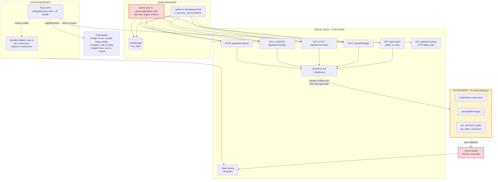
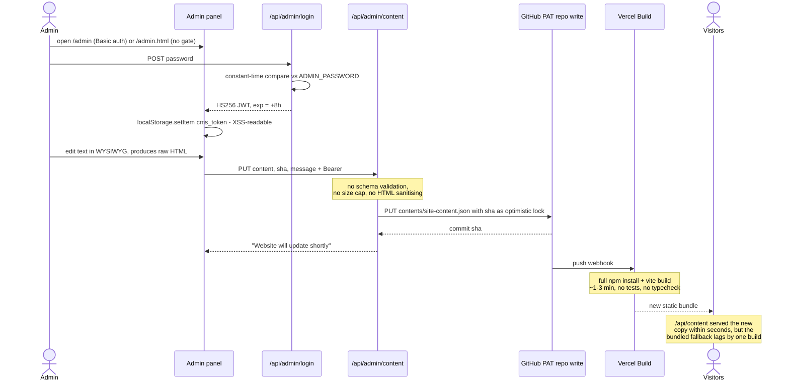
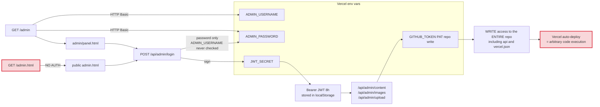
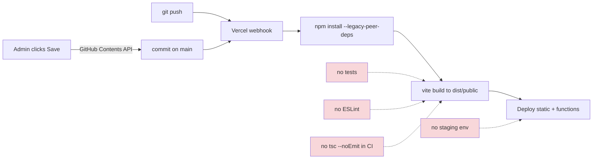
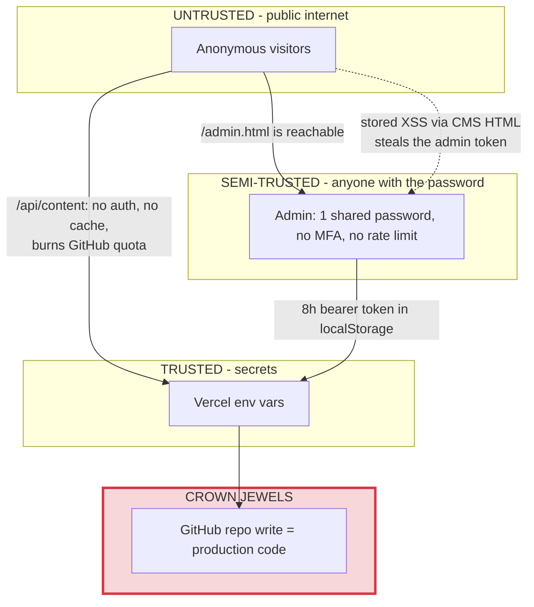

# StudyHub BD — System Architecture

> **Status:** As-built documentation of the system *as it exists today* (2026-10-31).
> This describes reality, not the target state. For problems found in this architecture
> see [`ASSESSMENT.md`](./ASSESSMENT.md); for the proposed target state see
> [`REMEDIATION-PLAN.md`](./REMEDIATION-PLAN.md).

---

## 1. What this system is

StudyHub BD is a **marketing / lead-generation website for a Bangladeshi study-abroad
consultancy**, with a self-service CMS bolted on so non-technical staff can edit copy.

| Attribute | Value |
|---|---|
| Type | Public marketing SPA + micro-CMS |
| Frontend | React 19 + TypeScript 5.6, Vite 7, Tailwind v4, shadcn/ui (Radix), wouter |
| Backend | 7 Vercel serverless functions, plain ESM JavaScript (no TypeScript) |
| **Database** | **None.** A single JSON file in a GitHub repo is the datastore |
| Hosting | Vercel (static `dist/public` + `/api/*` functions) |
| Auth | One shared admin password; two independent auth mechanisms |
| Public pages | 8 routes + 404 |
| Source size | ~8,300 LOC client (6,189 of it unused `ui/`), 536 LOC API |
| Content size | 24.8 KB JSON, 601 nodes, 5 levels deep, 14 top-level sections |

**The defining architectural decision is that git is the database.** Every content edit
is a GitHub commit, and every commit triggers a full Vercel rebuild of the entire site.
Everything below follows from that choice.

---

## 2. Runtime topology



---

## 3. Component inventory

### 3.1 Serverless functions (`api/`, 536 LOC, plain JS — **not type-checked**)

| Endpoint | File | Auth | Purpose |
|---|---|---|---|
| `GET /api/content` | `api/content.js` | **none (public)** | Reads `site-content.json` via GitHub API, returns JSON |
| `POST /api/admin/login` | `api/admin/login.js` | password | Compares `ADMIN_PASSWORD`, mints an 8-hour HS256 JWT |
| `GET`/`PUT /api/admin/content` | `api/admin/content.js` | Bearer JWT | Read / commit `site-content.json` |
| `GET`/`DELETE /api/admin/images` | `api/admin/images.js` | Bearer JWT | List / delete images in the repo |
| `POST /api/admin/upload` | `api/admin/upload.js` | Bearer JWT | Commit a base64 image to the repo |
| `GET /api/admin-panel` | `api/admin-panel.js` | **HTTP Basic** | Serves `admin/panel.html` |
| *(shared)* | `api/_lib/auth.js` | — | Hand-rolled JWT sign/verify (no library) |
| *(shared)* | `api/_lib/github.js` | — | GitHub Contents API wrapper, holds the PAT |

### 3.2 Frontend (`client/src`)

```
main.tsx
└── App.tsx
    ├── ErrorBoundary              <- renders raw error.stack to end users
    ├── ThemeProvider              <- switchable=false, effectively light-only
    │   └── CmsProvider            <- THE data source for the whole site
    │       └── TooltipProvider
    │           ├── Header         <- nav items HARDCODED, not from CMS
    │           ├── Router         <- wouter Switch, 8 routes + catch-all
    │           ├── Footer
    │           └── WhatsAppButton
    └── Toaster (sonner)
```

| Group | Files | Used? |
|---|---|---|
| Pages | Home, About, Services, Destinations, IELTS, Japanese, SuccessStories, Contact, NotFound | yes — all 9 |
| Components | Header, Footer, WhatsAppButton, RichText, ErrorBoundary | yes |
| Components | `Map.tsx`, `ManusDialog.tsx` | **dead** |
| Contexts | CmsContext, ThemeContext | yes |
| Hooks | `useMobile`, `usePersistFn`, `useComposition` | **dead** |
| Consts | `client/src/const.ts`, `shared/const.ts` | **dead** (template OAuth residue) |
| `components/ui/` | 53 shadcn files, 6,189 LOC | **4 used** (button, card, sonner, tooltip) — 49 dead |

### 3.3 Admin panels — **there are two, and they have diverged**

| | `admin/panel.html` | `client/public/admin.html` |
|---|---|---|
| Reached at | `/admin` (rewrite to `/api/admin-panel`) | `/admin.html` (plain static file) |
| HTTP Basic gate | yes | **no — publicly reachable** |
| Size | 1,246 lines | 409 lines |
| Editor | Full WYSIWYG (`contenteditable` + `execCommand`), structured editors for stats / destinations / stories / testimonials / JLPT levels | Flat form + raw JSON textarea |
| HTML escaping | partial — `xe()` helper, not applied to filenames | none |
| Security headers | `X-Frame-Options: DENY`, `nosniff`, `noindex` | none |

Both talk to the **same** `/api/admin/*` endpoints with the **same** token in
`localStorage`, so the Basic-auth wall on `/admin` protects nothing — `/admin.html`
walks around it.

---

## 4. Data flow — public visitor (read path)

```mermaid
sequenceDiagram
    actor V as Visitor
    participant CDN as Vercel CDN
    participant SPA as React SPA
    participant Fn as /api/content
    participant GH as GitHub API

    V->>CDN: GET /ielts
    CDN-->>V: index.html with EMPTY root div
    Note over V: no SSR - crawlers and<br/>social previews see nothing
    V->>CDN: GET /assets/index-hash.js
    CDN-->>V: bundle INCLUDES a full copy of site-content.json
    SPA->>SPA: render immediately with BUNDLED content
    Note over SPA: first paint = build-time snapshot
    SPA->>Fn: fetch /api/content
    Fn->>GH: GET /repos/owner/repo/contents/content/site-content.json
    Note over Fn,GH: authenticated with the PAT -<br/>every page view burns GitHub quota,<br/>Cache-Control: no-store
    GH-->>Fn: base64 blob
    Fn-->>SPA: JSON - NOT validated against any schema
    SPA->>SPA: setContent(data) then full re-render
    Note over SPA: visible content flash;<br/>on failure it silently keeps<br/>the stale bundled copy
```

**The content exists in three places at once** and they drift independently:

```
content/site-content.json   <- the "real" one in git
        │
        ├─[build-time import]-> JS bundle   (CmsContext.tsx:2)  <- served first
        └─[runtime fetch]─────> /api/content (reads git again)   <- swapped in after
```

## 5. Data flow — admin edit (write path)



### Image upload path

```
file picker -> FileReader.readAsDataURL -> base64 in a JSON body
  -> POST /api/admin/upload
  -> filename sanitised to [a-zA-Z0-9._-]  (extension NOT checked against mimeType)
  -> GitHub createFile/updateFile -> client/public/images/<name>
  -> rebuild -> served at https://site/images/<name>   <- same origin as the app
```

---

## 6. Authentication model



**Blast radius:** one password leads to a JWT, which unlocks a repo-write PAT, which can
commit to `api/**`, which triggers an automatic production deploy. There is no gap
between "CMS editor" and "run code on the production server". A single leaked password
is full remote code execution.

---

## 7. Content model map

`content/site-content.json` — 14 top-level sections, 601 nodes, depth 5, 24.8 KB.

```
global          siteName, tagline, phone1, phone2, email, address, website
                whatsapp, registrationLink, socialMedia{fb,ig,li,yt}, copyrightYear
header          logo, registerButtonText
home            hero{title,description,stats[]}, features[], cta
about           hero, mission, vision, values[], team
services        service definitions
servicesPage    page-specific copy for /services
destinations    country list (flags, descriptions, universities)
destinationsPage
successStories  student stories (name, university, image, quote)
successPage
ielts           course info, batches, fees
japanese        JLPT levels (N5-N1), course info
contact         phone/email/address (DUPLICATES global), mapEmbedUrl, mapDirectionsUrl
footer          footer copy
```

**Page to data binding** (all via the single `useCms()` context):

| Route | Component | Reads |
|---|---|---|
| `/` | `Home.tsx` | `global`, `home` |
| `/about` | `About.tsx` | `global`, `about` |
| `/services` | `Services.tsx` | `global`, `services`, `servicesPage` |
| `/destinations` | `Destinations.tsx` | `global`, `destinations`, `destinationsPage` |
| `/ielts` | `IELTS.tsx` | `global`, `ielts` |
| `/japanese` | `Japanese.tsx` | `global`, `japanese` |
| `/success-stories` | `SuccessStories.tsx` | `global`, `successStories`, `successPage` |
| `/contact` | `Contact.tsx` | `global`, `contact` |
| *(all)* | `Header`, `Footer`, `WhatsAppButton` | `global`, `header`, `footer` |

**Modelling characteristics:**

- No `id`/`slug`/`order`/`publishedAt` on most collection items — ordering is array position.
- No draft/publish split. Saving equals publishing to production immediately.
- No i18n structure; English and Bengali are mixed inside the same string fields.
- `contact.phone1`/`email`/`address` duplicate `global.*` — they can and do drift.
- Content strings contain **raw HTML** produced by the WYSIWYG, rendered through
  `RichText` into `dangerouslySetInnerHTML` with no sanitising.

---

## 8. Build and deploy pipeline



`vercel.json` configures only: a `/admin` to `/api/admin-panel` rewrite, `noindex` plus
`no-store` on `/admin`, and `no-store` on `/api/*`. **There is no SPA fallback rewrite**
— deep links such as `/ielts` must be verified against the live deployment
(see ASSESSMENT OPS-07).

---

## 9. Trust boundaries



**Boundary violations found** (details in `ASSESSMENT.md`):

1. `/admin.html` lets an unauthenticated request reach the admin UI, bypassing Basic auth.
2. `/api/content` lets an anonymous request consume the privileged GitHub PAT quota.
3. Stored XSS in CMS content crosses from visitor-visible output back into the admin
   session, because the public site and the admin panel share one origin and the token
   sits in `localStorage`.
4. The image-delete allow-list is bypassable, letting an admin token reach arbitrary
   GitHub REST paths with the PAT.

---

## 10. External dependencies at runtime

| Service | Used for | Where | Risk |
|---|---|---|---|
| GitHub Contents API | **the database** | every page view + every edit | single point of failure; rate limit ~5,000/h |
| Vercel | hosting, functions, build | — | build minutes consumed per content edit |
| Google Forms (`forms.gle`) | **actual lead capture** | `global.registrationLink` | leads live outside the system entirely |
| Google Maps embed | office location | `contact.mapEmbedUrl` | URL is fabricated (`0x0:0x0`) — wrong pin |
| Google Fonts | Playfair Display + Inter | `index.css:1` `@import` | render-blocking |
| `wa.me` | WhatsApp CTA | `WhatsAppButton` | — |
| Unsplash | 5 "student" photos | `successStories` | stock models presented as real students |
| `i.ibb.co.com` | 1 story photo | `successStories` | third-party hotlink, can vanish |
| `bing.com/images/search` | an Australia flag | `destinations` | **not an image — a search page; renders broken** |
| Umami | analytics | `index.html:21` | env vars unset, so it requests the literal `%VITE_ANALYTICS_ENDPOINT%/umami` |

---

## 11. Where this architecture breaks

| Limit | Reached at | Symptom |
|---|---|---|
| GitHub API rate limit (~5k/h on the PAT) | ~5,000 page views/hour, or a trivial curl loop | `/api/content` 503s; admin cannot save |
| Full rebuild per edit | every single save | 1–3 min from "Save" to the bundled copy updating; Vercel build minutes consumed to change a phone number |
| GitHub Contents API 1 MB file cap | ~40x current content size | `JSON.parse` of an empty body throws, so the CMS becomes unreadable **and unrepairable through the UI** |
| Single JSON blob, last-write-wins by `sha` | 2 concurrent editors | one editor's save is rejected with an opaque 500 |
| No query layer | first blog/news feature | cannot filter, paginate, or sort without loading all content |
| No relational model | lead capture, enquiry tracking | nowhere to put per-user data at all |

**Conclusion:** the git-as-database design is adequate for ~8 static marketing pages
edited by one person. It cannot support lead capture, enquiry tracking, a blog,
multi-user editing, or multi-language content — all of which are on the roadmap.
See `REMEDIATION-PLAN.md` for migration options.
