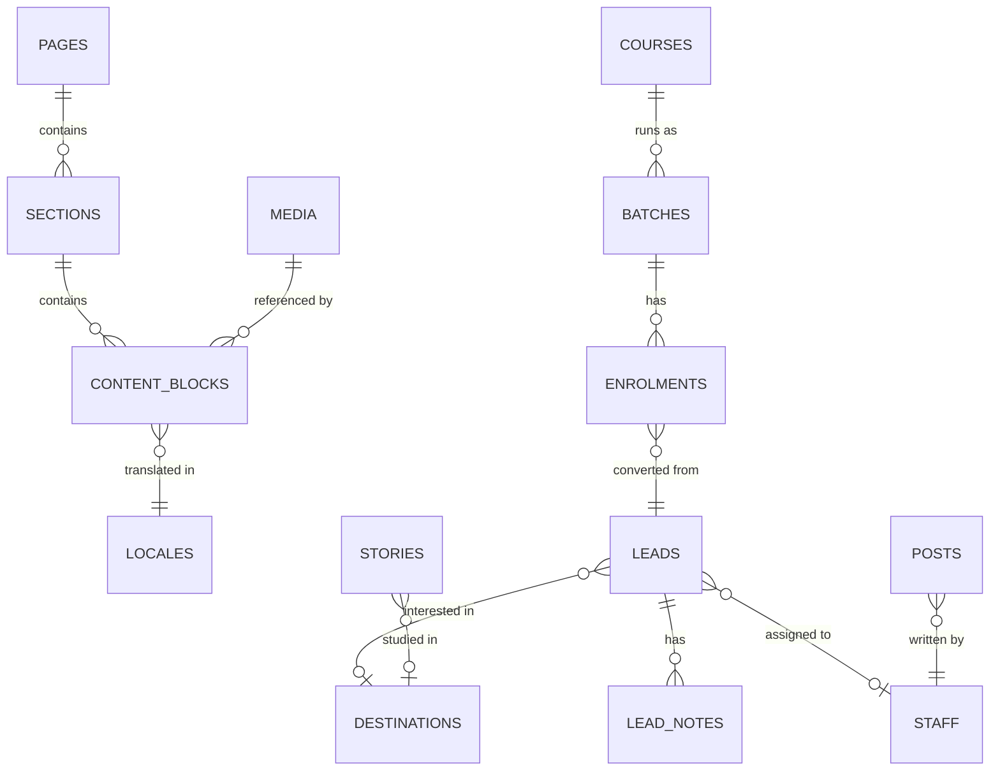
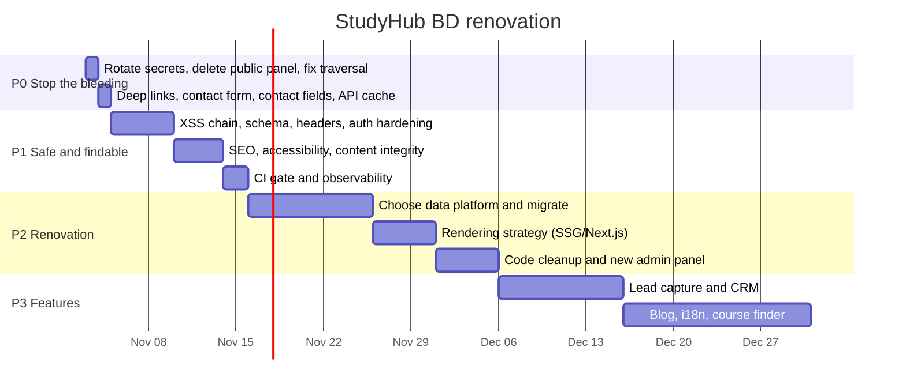

# StudyHub BD — Remediation and Renovation Plan

**Date:** 2026-10-31
**Input:** [`ASSESSMENT.md`](./ASSESSMENT.md) — 67 findings (6 Critical, 20 High, 27 Medium, 14 Low)
**Purpose:** What to fix, in what order, and what to build the next version on.

---

## How to read this

Four phases. **P0 and P1 are not optional** — P0 closes exploitable paths and stops an
active revenue leak; P1 makes the site safe to market. P2 is the renovation. P3 is new
product work, and it should not start before P2 chooses a data platform, because every
feature on the roadmap needs somewhere to store per-user data that does not exist today.

| Phase | Theme | Duration | Blocks what |
|---|---|---|---|
| **P0** | Stop the bleeding | 1–2 days | Everything |
| **P1** | Make it safe and findable | 1–2 weeks | Marketing spend |
| **P2** | Renovation | 3–4 weeks | New features |
| **P3** | New features | ongoing | — |

---

# P0 — Stop the bleeding (1–2 days)

Seven changes. Nothing else should ship first.

### P0.1 — Rotate every secret · `SEC-04, SEC-05`

```
1. GitHub → revoke the current GITHUB_TOKEN.
2. Create a FINE-GRAINED PAT:  one repository · Contents: write · 90-day expiry.
3. Generate new values:
      ADMIN_PASSWORD   openssl rand -base64 24
      JWT_SECRET       openssl rand -hex 32
4. Update Vercel → Settings → Environment Variables (Production + Preview).
5. Add a startup guard so placeholders can never ship:
```

```js
// api/_lib/auth.js
const JWT_SECRET = process.env.JWT_SECRET;
if (!JWT_SECRET || JWT_SECRET.length < 32 || /change-this/i.test(JWT_SECRET)) {
  return res.status(500).json({ error: 'Server misconfigured' });
}
```

Also enable **branch protection on `main`** with required review, and add a `CODEOWNERS`
entry for `api/**`, `vercel.json` and `package.json`. Point `GITHUB_BRANCH` at a dedicated
`content` branch so a CMS write can never land on code.

> If a PAT was ever committed before the history was stripped (`CLEAN_PUSH_INSTRUCTIONS.txt`
> suggests it was), treat it as compromised and audit the repo's recent commits.

### P0.2 — Delete the public admin panel · `SEC-03`

```bash
rm client/public/admin.html
```

One admin panel, one gate. `admin/panel.html` behind HTTP Basic is the one to keep.

### P0.3 — Fix the image-delete path check · `SEC-01`

Apply the allow-list regex plus `path.normalize` equality check from ASSESSMENT SEC-01 in
`api/admin/images.js`, and URL-encode every path segment in all five functions in
`api/_lib/github.js`.

### P0.4 — Verify SPA deep links · `OPS-07`

Open `https://<site>/ielts` directly in a fresh tab. If it 404s, add to `vercel.json`:

```json
{ "source": "/((?!api/).*)", "destination": "/index.html" }
```

If this is broken, 7 of 8 pages are unreachable from Google, ads and shared links — it
would dwarf every other SEO issue.

### P0.5 — Stop losing leads · `BIZ-01`

Ship whichever you can do today:

- **Fast (1 hour):** remove the dead form, replace it with the Google Form link plus a
  prominent "Call / WhatsApp us" block. Visitors stop being misled.
- **Proper (1 day):** `POST /api/contact` → zod validation → rate limit → honeypot →
  email notification (Resend/SendGrid) **and** an append to a store. Wire the form with
  `react-hook-form` + `zod`, with proper `id`/`htmlFor`/`name`/`autoComplete`.

Do not leave a form that looks functional and is not.

### P0.6 — Make the office phone number editable · `CNT-06`

Thirty minutes, and it fixes a live defect nobody has noticed. `Contact.tsx` renders
`content.contact.phone1/phone2/email/address/website`; **neither admin panel writes those
fields.** Updating the phone number in the CMS changes the header, footer and WhatsApp
button and leaves the Contact page showing the old number permanently.

```diff
- const c = content.contact;
+ const c = { ...content.contact, ...content.global };   // global wins for shared fields
```

Then delete the duplicated keys from `contact.*` in `site-content.json` so the two copies
cannot drift again, and keep `contact.hero`, `contact.mapEmbedUrl`, `contact.mapDirectionsUrl`
and the CTA fields, which *are* editable.

### P0.7 — Cache `/api/content` · `SEC-06`

```js
res.setHeader('Cache-Control', 'public, s-maxage=60, stale-while-revalidate=600');
```

and remove `/api/content` from the blanket `no-store` rule in `vercel.json` (keep
`no-store` for `/api/admin/*`). This alone removes the trivial DoS that locks the admin
out of their own CMS.

---

# P1 — Make it safe and findable (1–2 weeks)

### P1.1 — Close the XSS chain · `SEC-02, SEC-07, SEC-12, FE-02`

These four are one piece of work, because they all come down to "content is trusted and
should not be".

1. `npm i dompurify @types/dompurify` — sanitise in `RichText` with a tag/attribute
   allow-list.
2. Add `shared/content-schema.ts` (zod). Derive `SiteContent` via `z.infer`. `safeParse`
   in `CmsContext`; keep the fallback on failure and surface an `error` in the context.
3. Import the **same schema** in `api/admin/content.js` and reject invalid writes before
   committing. Cap the serialised size at 512 KB.
4. Add the `safeUrl()` helper and apply it to every content-driven `href` and the map
   `iframe src` (plus `sandbox` and `title`).
5. Convert plain-text fields away from `RichText` so the HTML surface shrinks to the few
   fields that genuinely need markup.

### P1.2 — Security headers · `SEC-08`

Move the inline scripts in `admin/panel.html` to an external file **first**, then add the
global CSP / HSTS / `frame-ancestors` / `nosniff` / `Referrer-Policy` block from
ASSESSMENT SEC-08 to `vercel.json`.

### P1.3 — Auth hardening · `SEC-05, SEC-11`

Rate-limit both login paths (`@upstash/ratelimit`, 5 per 15 min per IP). Require `exp` and
`role === 'admin'` in `verifyToken`; validate the JOSE header; use
`crypto.timingSafeEqual`; drop the TTL to 60 minutes. Move the token from `localStorage`
to an `httpOnly; Secure; SameSite=Strict` cookie. Strongly consider replacing
`api/_lib/auth.js` with `jose`.

### P1.4 — Upload hardening · `SEC-10`

Drop `image/svg+xml`. Require the extension to match the MIME type, verify magic bytes,
validate base64, type-check every field, and abort on any non-404 `getFile` error.

### P1.5 — SEO and metadata · `SEO-01, SEO-02`

Add to `index.html`: description, canonical, `og:*`, `twitter:*`, favicon, `theme-color`,
and JSON-LD (`EducationalOrganization` + `LocalBusiness` with the real NAP). Add
`public/robots.txt` and `public/sitemap.xml`. Add per-route `<title>` and description via
React 19's native metadata hoisting, sourcing the strings from the CMS. Remove the
`TO BE DELETED` template comment block.

**This is the highest commercial ROI item after the contact form.** Right now every link
the agency shares on Facebook or WhatsApp renders as a bare, image-less card.

### P1.6 — Accessibility · `A11Y-01 … A11Y-07`

Remove `maximum-scale=1`. Introduce `--golden-text: #8A6D0B` for body copy and links,
reserve `#D4AF37` for large display text and backgrounds, and always pair golden
backgrounds with black text. Add `htmlFor`/`id` to form fields, `aria-label` +
`aria-expanded` to the mobile menu and WhatsApp button, `motion-safe:` guards on the
infinite animations, a skip-to-content link, and `aria-current` on the active nav item.

### P1.7 — Content integrity · `CNT-01, CNT-02, CNT-03`

Replace the Bing search URL with a real flag image. Replace the five Unsplash stock
"students" with real consented photos or initials avatars. Self-host the `i.ibb.co` image.
Set the real social media URLs or hide the icons. Update `copyrightYear`. Regenerate
`mapEmbedUrl` from Google Maps → Share → Embed. Write a real Privacy Policy and Terms page
— a business handling passport and financial data needs them.

### P1.8 — CI gate · `OPS-01`

Add ESLint with `eslint-plugin-react-hooks` and `eslint-plugin-jsx-a11y`. Change the build
to `npm ci && tsc --noEmit && vitest run && vite build`. Add smoke tests for the content
schema and `RichText` sanitising. Enable Vercel preview deployments as staging.

### P1.9 — Observability · `OPS-04`

Sentry (or equivalent) for frontend and function errors. An uptime check on `/api/content`.
Fix or remove the broken Umami tag — **no analytics are being collected today**. Add a
scheduled job that commits a dated snapshot of `site-content.json` to a backup location.

---

# P2 — Renovation (3–4 weeks)

### P2.1 — Choose the data platform

This is the decision that gates everything in P3. The current design cannot hold
per-user data at all.

| | **A. Harden git-CMS** | **B. Headless CMS** | **C. Postgres + Supabase** ⭐ |
|---|---|---|---|
| What changes | Keep JSON in git; add schema, drafts, backups | Content moves to Sanity/Contentful/Payload | Content and all app data move to Postgres |
| Effort | ~1 week | ~2 weeks | ~3–4 weeks |
| Cost | $0 | $0–99/mo | $0–25/mo |
| Lead capture | ✗ still needs a separate store | ✗ still needs a separate store | ✓ native |
| Blog / news | awkward | ✓ | ✓ |
| Multi-editor | ✗ last-write-wins | ✓ | ✓ |
| Draft / preview | ✗ | ✓ | ✓ |
| Media handling | manual, in-repo | ✓ CDN + transforms | ✓ Supabase Storage |
| i18n (EN/BN) | manual | ✓ | ✓ |
| Rebuild per edit | ✓ 1–3 min | optional | not required |
| Removes SEC-04 RCE chain | partially | ✓ | ✓ |

**Recommendation: C (Supabase).** Not because the current site needs a database, but
because *every item on the P3 roadmap does* — leads, enquiries, course enrolments,
testimonials with approval state, and bilingual content. B solves content but leaves you
needing a second system for leads within a month. C also breaks the SEC-04 chain outright,
because a content write stops being a code write.

If budget or appetite is limited, **A is a legitimate holding position** — but only with
P1.1 (schema + sanitising) done, and with the understanding that P3 will force the
migration anyway.

### P2.2 — Target data model (option C)



| Table | Key fields | Replaces / enables |
|---|---|---|
| `pages` / `sections` / `content_blocks` | `slug`, `order`, `locale`, `status(draft\|published)`, `published_at` | `site-content.json`, plus drafts and i18n |
| `locales` | `code(en\|bn)`, `is_default` | the mixed-language strings |
| `media` | `path`, `alt_en`, `alt_bn`, `width`, `height`, `mime` | `client/public/images/`, plus real alt text |
| **`leads`** | `name`, `email`, `phone`, `subject`, `message`, `source`, `status`, `assigned_to`, `created_at` | **BIZ-01 — the missing table** |
| `lead_notes` | `lead_id`, `author`, `body`, `created_at` | follow-up history |
| `destinations` | `slug`, `name_en`, `name_bn`, `flag_media_id`, `order` | the `destinations` array |
| `courses` / `batches` | `slug`, `title`, `fee`, `starts_at`, `seats`, `seats_taken` | IELTS and Japanese pages, plus real enrolment |
| `enrolments` | `batch_id`, `lead_id`, `status`, `paid_amount` | course sign-ups |
| `stories` | `student_name`, `university`, `destination_id`, `media_id`, `quote`, `consent_given`, `approved` | fixes CNT-01's stock-photo problem structurally |
| `posts` | `slug`, `title`, `body`, `locale`, `status`, `published_at`, `author_id` | blog / news / visa updates |
| `staff` | `email`, `name`, `role(admin\|editor\|counsellor)` | **replaces the one shared password** |

Row-Level Security: `pages`/`posts`/`stories` public-readable where `status='published'`;
`leads`/`enrolments` readable only by authenticated staff; writes gated by role.

### P2.3 — Rendering strategy

Move off pure client-side rendering. For a marketing site that lives on search and social,
**SSG with incremental revalidation** is the right shape:

- **Lowest effort:** stay on Vite, add `vite-react-ssg` to pre-render the 8 static routes.
- **Recommended:** migrate to **Next.js App Router** on Vercel — SSG + ISR, native
  metadata API (fixes SEO-01 properly), server actions for the contact form, image
  optimisation (fixes FE-07), and `next-intl` for EN/BN. The component code ports largely
  unchanged; `wouter` routing is replaced by the file-system router.

### P2.4 — Code cleanup · `FE-09 … FE-18, OPS-03, OPS-06`

Delete `Map.tsx`, `ManusDialog.tsx`, `client/src/const.ts`, `shared/const.ts`, the three
unused hooks, and the 49 unused `ui/` files. Remove `framer-motion`, `axios`, `streamdown`,
`nanoid` and the orphaned Radix packages. Remove `vite-plugin-manus-runtime`, the
`allowedHosts` list, the `@assets` alias and the `server/**/*` tsconfig include. Delete
`studyhubbdwadmin-main.zip` and extend `.gitignore` (`.env*` with `!.env.example`,
`.vercel`, `*.pem`, `*.key`, `*.zip`). Extract the duplicated hero and CTA sections into
`<PageHero>` and `<CtaSection>` (~400 lines). Rewrite `README.md` with real setup, env and
deploy instructions.

### P2.5 — Rebuild the admin panel

The current panel is 1,246 lines of hand-written HTML with `document.execCommand` (a
deprecated API) and inline event handlers that the P1.2 CSP will break. Rebuild it as a
React route inside the app, using the existing shadcn components (which are already
installed and currently unused), with per-user staff logins, role-based access, draft
preview, and an audit trail.

---

# P3 — New features

Each item lists what it depends on, so nothing gets started before its foundation exists.

### Tier 1 — directly revenue-generating

| Feature | Depends on | Why |
|---|---|---|
| **Lead capture + CRM pipeline** | P2.1 (C), P0.5 | The core business function. Form → `leads` → assigned counsellor → status pipeline → follow-up reminders. Today leads vanish. |
| **WhatsApp Business API integration** | leads | In Bangladesh WhatsApp is the primary channel. Auto-acknowledge every enquiry, notify the counsellor, and keep the thread against the lead record. |
| **Course enrolment + online payment** | `courses`, `batches`, `enrolments` | bKash / Nagad / SSLCommerz for IELTS and Japanese batch fees. Replaces the Google Form. |
| **Counsellor appointment booking** | `staff`, `leads` | Calendar slots, reminders. High conversion for study-abroad. |

### Tier 2 — traffic and trust

| Feature | Depends on | Why |
|---|---|---|
| **Blog / news / visa updates** | `posts`, P2.3 (SSG) | The main organic-search lever. Visa rule changes are exactly what prospective students search for. |
| **Bengali / English toggle** | `locales`, P2.3 | Half the audience reads Bengali. Currently the languages are mixed inside single fields. |
| **University / course finder** | `destinations`, `courses` | Filterable search by country, subject, budget, intake. The single highest-intent page type for this sector. |
| **Verified success stories** | `stories.consent_given`, `approved` | Fixes CNT-01 structurally — no story publishes without a consent flag. |
| **Scholarship / intake deadline tracker** | `posts`, `courses` | Recurring return visits. |

### Tier 3 — operational leverage

| Feature | Depends on | Why |
|---|---|---|
| **Student document portal** | `leads`, Storage, RLS | Passport, transcripts, SOP — replaces email attachments. **Handles sensitive personal data: do not start before P1 is complete.** |
| **Application status tracker** | `enrolments` | Cuts "what's happening with my application?" phone calls. |
| **Staff dashboard** | P2.5 | Leads by source, conversion by counsellor, batch fill rates. |
| **Automated email sequences** | `leads` | Nurture enquiries that do not convert immediately. |

---

## Sequencing summary



**Non-negotiable ordering:** P0 before anything. P1.1 (sanitising + schema) before any
content work. P2.1 (data platform) before any P3 feature. The document portal in Tier 3
must not start before P1 is complete — it handles passports.
